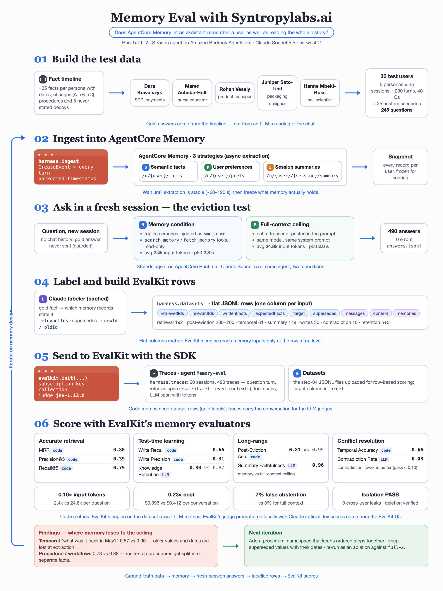

# Evaluating AgentCore Memory with EvalKit memory metrics

This cookbook evaluates **Amazon Bedrock AgentCore Memory** behind a **Strands** agent, using **EvalKit**'s managed memory evaluators. It asks one question: does memory let an assistant remember a user across sessions about as well as giving it the user's whole history?



*Memory Eval with Syntropylabs.ai: the workflow the notebook follows.*

The notebook covers these steps:

1. Builds ground-truth test data from a dated fact timeline (facts that change, procedures, never-stated decoys).
2. Creates an AgentCore Memory with semantic, user-preference and summary strategies in actor-scoped namespaces.
3. Ingests history as backdated `CreateEvent` calls, waits for extraction and snapshots the records.
4. Runs a Strands agent with a top-K memory index hook, an event-capture hook and a `search_memory` tool, and compares it with a full-context ceiling.
5. Builds flat EvalKit rows, computes the seven code metrics locally, scores the three LLM-judge metrics, and sends rows and traces to EvalKit.

## Prerequisites

- Python 3.12 and [uv](https://docs.astral.sh/uv/) (or pip).
- **Live runs only:** an AWS account with access to Bedrock AgentCore Memory and a Bedrock model (the default is Claude Sonnet 5.5, `global.anthropic.claude-sonnet-5-5`), plus an EvalKit subscription key.

## How to run

**Offline (default, no credentials).** Every AWS and EvalKit cell is guarded by `RUN_LIVE = False` and prints what it would do. Results come from `sample_data/`.

```bash
uv run --with jupyter jupyter lab agentcore_memory_eval_with_evalkit.ipynb
```

**Live.** Set `RUN_LIVE = True` in the first code cell, then export the variables listed in `.env.example`. This creates AWS resources and costs money; the last cell deletes the memory.

```bash
uv run --with jupyter --with-requirements requirements.txt jupyter lab agentcore_memory_eval_with_evalkit.ipynb
```

EvalKit evaluator rule ids are org-scoped. Copy them from the EvalKit UI into the `RULE_IDS` placeholders in section 10.

## Files

| File | What it is |
|---|---|
| `agentcore_memory_eval_with_evalkit.ipynb` | The cookbook notebook, saved with offline outputs |
| `agentcore_memory_eval_with_evalkit.html` | HTML export of the executed notebook |
| `requirements.txt` | Packages for the live path |
| `.env.example` | Environment variable names (no values) |
| `images/eval_workflow.png` | Workflow poster |
| `sample_data/sre_persona_sample.json` | Trimmed synthetic persona: 14 facts, 7 sessions, 11 questions |
| `sample_data/full2_sre_rows.json` | Precomputed EvalKit rows, example answers and judge verdicts for that persona |
| `sample_data/full2_summary.json` | Headline numbers from the full run |

## Results (full run, 30 users, 245 questions, 490 answers)

| Family | Metric | Type | Memory | Full context |
|---|---|---|---|---|
| Accurate retrieval | MRR | code | 0.798 | n/a |
| | Precision@5 | code | 0.394 | n/a |
| | Recall@5 | code | 0.788 | n/a |
| Test-time learning | Write Recall | code | 0.663 | n/a |
| | Write Precision | code | 0.314 | n/a |
| | Knowledge Retention | LLM judge | 0.80 | 0.87 |
| Long-range | Post-Eviction Accuracy | code | 0.805 | 0.945 |
| | Summary Faithfulness | LLM judge | 0.96 | n/a |
| Conflict resolution | Temporal Accuracy | code | 0.664 | n/a |
| | Contradiction Rate (lower is better) | LLM judge | 0.080 | n/a |

Memory uses **0.10×** the input tokens at **0.23×** the cost per conversation, with 7% false abstention against 3% for full context. Its weakest areas are **temporal** questions (0.57 vs 0.90) and **procedural / workflow** memory (0.73 vs 0.88).

The code metrics were computed with EvalKit's engine. The LLM-judge numbers are a local Claude replica of EvalKit's judges; official scores come from the EvalKit UI.

## Data and licence

Everything in `sample_data/` is **synthetic and invented**. The persona, companies, people and conversations are fictional and were generated by an LLM from a hand-designed fact timeline, so the data contains no real personal information. Memory record ids have been replaced with short aliases (`rec-NNN`).
